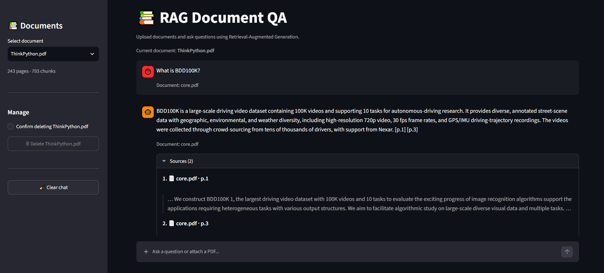

# 📄 RAG Document QA

**A Retrieval-Augmented Generation (RAG) application for document-grounded question answering.**

Upload PDF documents, ask questions about their content, and receive answers based on retrieved document context, with source references when available.

The project combines semantic retrieval, vector search, LLM-based answer generation, document management, and evaluation scripts in an interactive Streamlit application.

## ✨ Key Features

- PDF document ingestion and text extraction
- Document chunking and embedding generation
- Vector similarity search with ChromaDB
- Hybrid retrieval combining vector search and BM25
- Reciprocal Rank Fusion (RRF) for result ranking
- Cross-Encoder reranking
- Query transformation and expansion
- LLM-powered answer generation
- Source references with page numbers
- Support for document uploads through the interface

## 🛠️ Tech Stack

- **Language:** Python
- **Frontend:** Streamlit
- **LLM:** OpenAI API
- **Vector Database:** ChromaDB
- **Embeddings:** Sentence Transformers
- **Retrieval:** Vector Search, BM25, Hybrid Search
- **Reranking:** Cross-Encoder
- **Document Processing:** PyMuPDF / LangChain

## 🏗️ RAG Architecture

1. **Document Ingestion:** Load and extract text from PDF files.
2. **Chunking:** Split extracted text into smaller chunks.
3. **Embedding:** Convert text chunks into vector representations.
4. **Retrieval:** Retrieve relevant chunks using vector search and BM25.
5. **Ranking:** Combine retrieval results using Reciprocal Rank Fusion and rerank candidates with a Cross-Encoder.
6. **Generation:** Use the retrieved context to generate answers with an LLM.
7. **Citation:** Display source documents and page references.


## ⚠️ Limitations

- Answer quality depends on the content and structure of uploaded documents.
- Retrieval may not always identify every relevant detail, especially information embedded in figures or tables.
- LLM-generated answers should be verified against the cited source pages.


## 🏗️ System Architecture

```text
             ┌──────────────────────┐
             │   PDF Documents      │
             └──────────┬───────────┘
                        │
                        ▼
             ┌──────────────────────┐
             │   Document Loading   │
             │   & Chunking         │
             └──────────┬───────────┘
                        │
                        ▼
             ┌──────────────────────┐
             │ Embedding Generation │
             └──────────┬───────────┘
                        │
                        ▼
             ┌──────────────────────┐
             │      ChromaDB        │
             │   Vector Storage     │
             └──────────┬───────────┘
                        │
 User Question ─────────┤
                        ▼
             ┌──────────────────────┐
             │ Retrieval / Reranking│
             └──────────┬───────────┘
                        │
                        ▼
             ┌──────────────────────┐
             │ Context-Based Answer │
             │   Generation (LLM)   │
             └──────────┬───────────┘
                        │
                        ▼
             ┌──────────────────────┐
             │ Answer + Sources     │
             │ Streamlit Interface  │
             └──────────────────────┘
```

### Processing Pipeline

1. **Ingestion:** Load PDF documents and split their content into manageable chunks.
2. **Embedding:** Transform document chunks into numerical vector representations.
3. **Indexing:** Store vectors and associated metadata in ChromaDB.
4. **Retrieval:** Retrieve relevant chunks for the user's question.
5. **Generation:** Use the retrieved context to generate a grounded answer.
6. **Source Attribution:** Display supporting document references when available.
7. **Evaluation:** Run test scripts to assess retrieval and answer behavior.

## 📁 Project Structure

```text
rag-document-qa/
├── app/
│   ├── ingestion/
│   ├── retrieval/
│   ├── generation/
│   ├── document_manager.py
│   └── rag_pipeline.py
├── frontend/
│   └── streamlit_app.py
├── tests/
├── data/
│   └── documents/       # Local PDF documents
├── build_vector_db.py
├── requirements.txt
├── .gitignore
└── README.md
```

> The structure above describes the intended organization. Local environment files, generated vector databases, and private documents should not be committed to the repository.

## 🚀 Getting Started

### Prerequisites

- Python installed on your machine
- An OpenAI API key for LLM-based answer generation
- Git
- A PDF document you are authorized to process

### 1. Clone the Repository

```bash
git clone https://github.com/duydang03/rag-document-qa.git
cd rag-document-qa
```

### 2. Create a Virtual Environment

**Windows PowerShell**

```powershell
python -m venv venv
.\venv\Scripts\Activate.ps1
```

### 3. Install Dependencies

```bash
python -m pip install --upgrade pip
pip install -r requirements.txt
```

### 4. Configure Environment Variables

Create a `.env` file in the project root and configure the OpenAI API key using the environment variable name expected by the application.

Example:

```dotenv
OPENAI_API_KEY=your_api_key_here
```

Make sure the application loads this variable correctly. Never commit `.env` or expose API keys in source code.

### 5. Add a PDF Document

You can either:

- Upload a PDF through the Streamlit interface, or
- Place an authorized PDF in the project's configured document directory.

### 6. Build the Vector Database (If Needed)

```bash
python build_vector_db.py
```

Run this step when you need to build or rebuild the vector index from the configured documents. If document indexing is already handled through the application, follow the existing workflow instead.

### 7. Launch the Application

```bash
streamlit run frontend/streamlit_app.py
```

Open the local URL displayed in the terminal, usually `http://localhost:8501`.

## Demo

Explore how RAG Document QA turns PDF documents into searchable knowledge.

### 🚀 Live Demo

[Try the application](https://rag-document-w1129pdd.streamlit.app/)

### Application Preview



*Ask questions about a selected PDF, receive context-grounded answers, and expand **Show Sources** to inspect the retrieved passages and page references.*

### How It Works

1. **Upload or select a PDF** — Choose a document to query.
2. **Ask a question** — Enter a natural-language question in the chat interface.
3. **Retrieve relevant context** — Hybrid retrieval combines vector search and BM25 ranking.
4. **Generate a grounded answer** — The LLM answers using the retrieved document context.
5. **Verify the sources** — Expand *Show Sources* to review source documents, page numbers, and retrieved text excerpts.

### Key Capabilities

- PDF ingestion and document indexing
- Hybrid retrieval with Reciprocal Rank Fusion (RRF)
- Query rewriting for retrieval
- Source-aware answers with page references
- Abstention when the available context does not support an answer
- Automated quality and end-to-end regression evaluation

## 🧪 Evaluation

The RAG pipeline was evaluated through retrieval benchmarking, automated answer-quality tests, and end-to-end regression tests.

### 1. Retrieval Benchmark

Different chunk sizes and overlaps were evaluated to measure retrieval performance.

| Chunk Size / Overlap | Number of Chunks | Hit@1 | Hit@3 | Hit@5 | MRR@3 | Keyword Coverage |
|---|---:|---:|---:|---:|---:|---:|
| 500 / 100 | 132 | 0% | 80% | 100% | 0.3833 | 95% |
| 750 / 150 | 92 | 20% | 100% | 100% | 0.6000 | 100% |
| 800 / 200 | 90 | 80% | 100% | 100% | 0.9000 | 95% |
| 1000 / 200 | 69 | 40% | 100% | 100% | 0.7000 | 73.33% |

These results are from the recorded chunking benchmark. They represent a separate experiment from the latest automated quality and end-to-end test runs.

### 2. Automated RAG Quality Evaluation

The automated quality evaluation checks answerability, abstention behavior, and citation handling.

| Metric | Latest Result |
|---|---:|
| Total test cases | 26 |
| Passed | 26 / 26 |
| Review required | 0 |
| Failed | 0 |
| Errors | 0 |
| Answerable pass rate | 100% |
| Abstention rate | 100% |
| Average latency | 2.15 seconds |

**Result:** All 26 test cases passed in the latest reported quality evaluation.

### 3. End-to-End Regression Testing

The end-to-end evaluation tests the complete question-answering pipeline.

| Metric | Latest Result |
|---|---:|
| Total questions | 15 |
| Successful runs | 15 / 15 |
| Errors | 0 |
| Answered questions | 15 |
| Abstained questions | 0 |
| Missing citations | 0 |
| Citation mismatches | 0 |
| Average latency | 2.335 seconds |

**Result:** All 15 end-to-end test runs completed successfully, with no reported errors, missing citations, or citation mismatches.

### 4. Evaluation Notes

- Retrieval benchmarking measures how effectively relevant document chunks are retrieved.
- Quality evaluation measures the behavior of the RAG pipeline against its automated test cases.
- End-to-end testing checks whether the complete pipeline runs successfully and returns answers with the expected citation format.
- The reported results apply to the tested datasets and test cases; they do not guarantee perfect performance on every document or question.
- Latency may vary depending on the document, query, embedding model, API response time, and runtime environment.


## 🔒 Security Considerations

- Keep API keys and `.env` files out of version control.
- Do not publish private PDFs or sensitive document contents.
- Avoid committing generated vector databases and local environment folders.
- Only process documents you have permission to use.
- Configure secrets securely before deploying the application.

## 🔮 Future Improvements

- [ ] Expand evaluation to more documents and question types.
- [ ] Improve retrieval confidence and abstention logic.
- [ ] Add automated test execution and continuous integration.
- [ ] Improve document versioning and re-indexing.
- [ ] Deploy a public demo with secure secret management.
- [ ] Document evaluation methodology and metric definitions.

## 👨‍💻 Author

**Phạm Đăng Duy**

- LinkedIn: [pham-dang-duy](https://www.linkedin.com/in/pham-dang-duy)
- GitHub: [duydang03](https://github.com/duydang03)

This project demonstrates practical experience in retrieval-augmented generation (RAG), document ingestion, hybrid retrieval, source citation, and automated evaluation.

---

**Note:** Evaluation results are specific to the tested dataset and configuration. Broader validation is needed before drawing conclusions about general-purpose performance.
